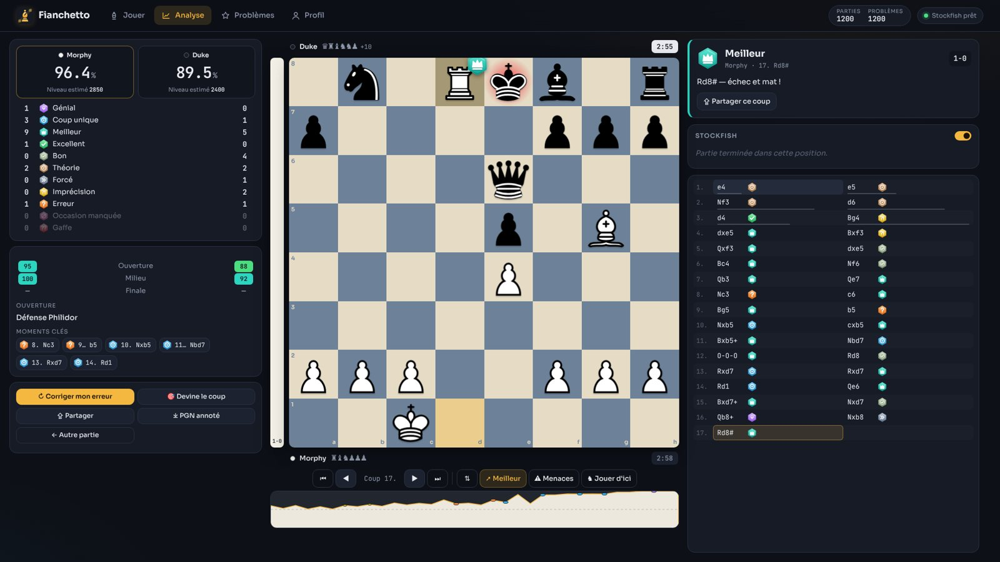
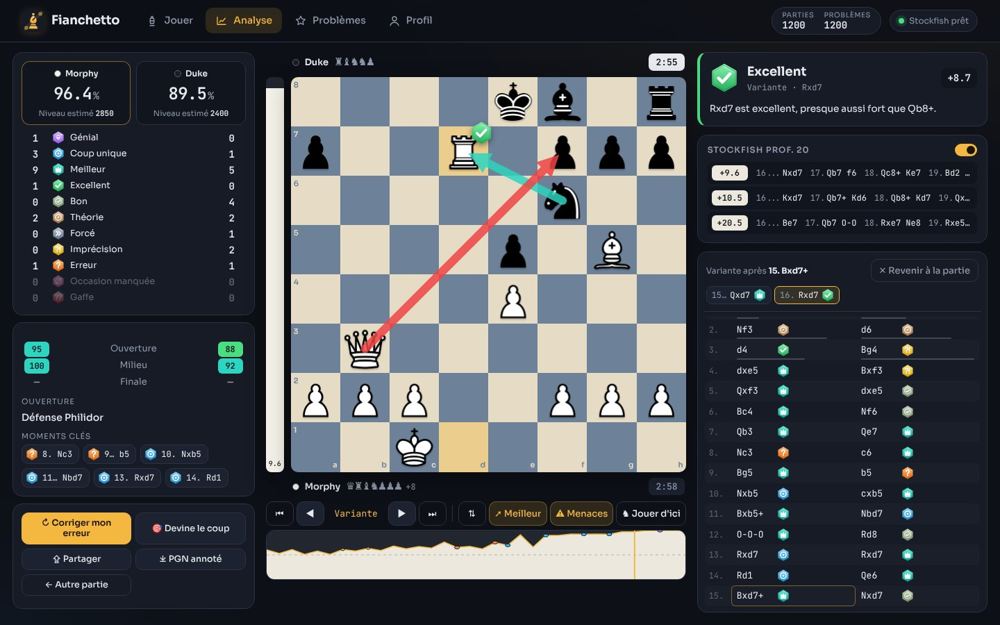
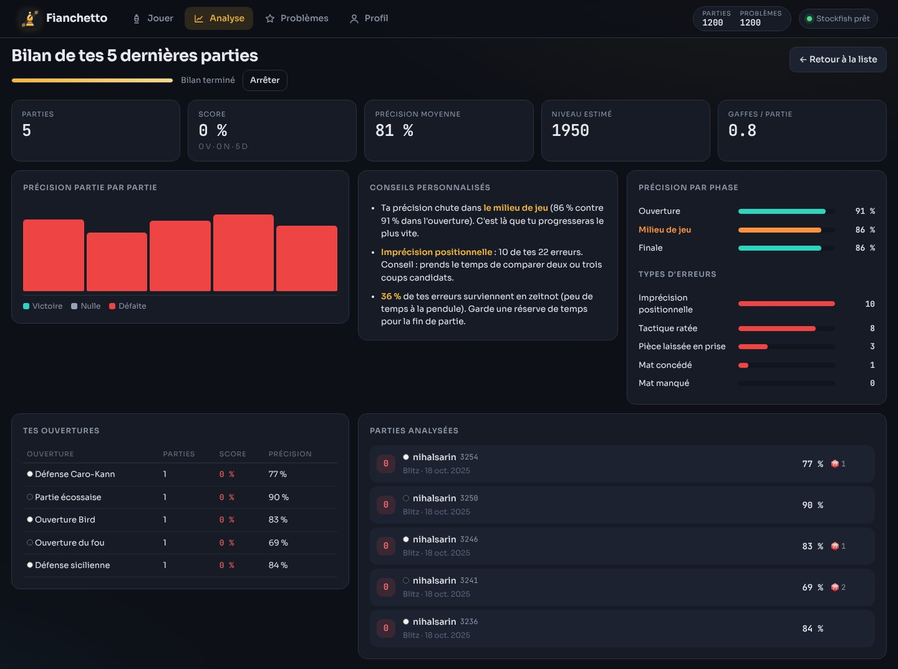
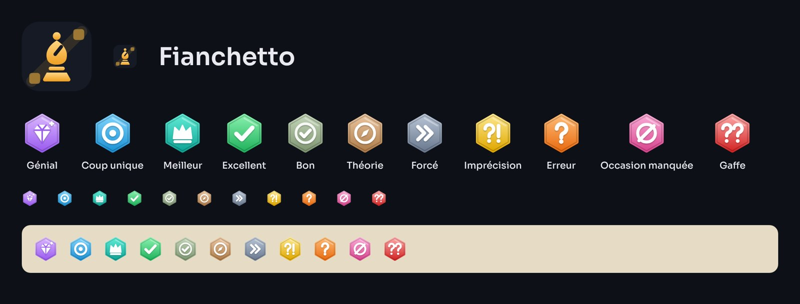

# ♝ Fianchetto

**Application web d'échecs : jouer contre des bots, analyser ses parties Chess.com / Lichess et s'entraîner aux tactiques — 100 % dans le navigateur, sans serveur ni compte.**

Projet personnel de Matéo Bourdin (BUT Informatique, IUT d'Annecy).

**▶ Essayer en ligne : https://mateobourdin.github.io/fianchetto/** · [Mon portfolio](https://mateobourdin.github.io/)



| Exploration libre | Bilan multi-parties |
|---|---|
|  |  |



## Fonctionnalités

### Analyse de parties (le cœur du projet)
- **Import direct** depuis Chess.com (API publique *Published-Data*, par mois) et Lichess (API publique), ou par **PGN collé / fichier**.
- **Stockfish** (WebAssembly) tourne dans un Web Worker : aucune donnée n'est envoyée à un serveur.
- **Rapport complet** :
  - précision par joueur et **niveau de jeu estimé** ;
  - 11 catégories de coups (Génial, Coup unique, Meilleur, Excellent, Bon, Théorie, Forcé, Imprécision, Erreur, Occasion manquée, Gaffe) ;
  - **précision par phase** (ouverture / milieu / finale) ;
  - **nom de l'ouverture** (livre de 119 lignes, gestion des transpositions) ;
  - **graphe d'évaluation** cliquable, **moments clés**, temps passé par coup (horloges PGN) ;
  - commentaire en français pour chaque coup, flèche du meilleur coup, lecture animée de la meilleure suite ;
  - **export PGN annoté** (NAG + commentaires + `[%eval]`).
- **Passe de vérification** : chaque erreur détectée est ré-analysée plus profondément avant d'être confirmée (élimine les faux positifs dus à l'horizon du moteur).
- Rapports mis en cache localement (rouvrir une analyse est instantané).
- **Interface sans défilement** : rapport, échiquier et coach tiennent dans l'écran (grille 3 colonnes qui s'adapte à la hauteur de la fenêtre, puis 2 et 1 colonne sur petits écrans).

### Exploration libre de l'analyse
- **Déplace n'importe quelle pièce** pendant l'analyse : la variante est créée, chaque coup est classé et commenté en direct.
- **3 lignes moteur continues** (jusqu'à profondeur 20) qui s'affinent en temps réel ; clic sur une ligne pour la jouer.
- **Flèche du meilleur coup**, **menaces adverses** (coup « nul » analysé), molette et flèches du clavier pour naviguer.
- Pendules reconstituées, matériel capturé, clic sur une catégorie (ex. Gaffe) pour sauter au coup concerné.

### Entraînement à partir de tes parties
- **Réessayer ce coup** : rejoue chaque erreur jusqu'à trouver mieux (vérifié par le moteur), indice et solution, enchaînement sur l'erreur suivante.
- **Devine le coup** : rejoue la partie dans la peau d'un joueur ; 5 points pour le coup joué ou celui du moteur, moins selon la qualité de ton choix.
- **Jouer d'ici** : reprends n'importe quelle position de l'analyse contre un bot.

### Bilan multi-parties
- Analyse en lot de tes 5 à 30 dernières parties Chess.com / Lichess.
- Précision partie par partie, score, niveau estimé, **précision par phase** (phase faible mise en évidence).
- **Typologie des erreurs** : pièce laissée en prise, mat concédé, mat manqué, tactique ratée, imprécision positionnelle.
- **Erreurs en zeitnot** (à partir des horloges), statistiques par ouverture et couleur, **conseils personnalisés générés**.

### Partage
- **Carte PNG 1200×630** d'un coup génial ou du rapport complet, téléchargeable ou copiable.

### Jouer contre des bots
- 6 bots à personnalité (500 → 2500), basés sur Stockfish en MultiPV avec température, erreurs volontaires et coups aléatoires dosés.
- **Qualité de chaque coup affichée en direct** pendant la partie (analyse asynchrone, ne bloque jamais le jeu), précision en direct, barre d'évaluation, indice, reprise de coup.
- Classement Elo (formule FIDE, K dégressif) et historique de progression.

### Problèmes
- **Base Lichess** (licence CC0, plus de 3 millions de problèmes) filtrable par thème et difficulté.
- **Pack hors-ligne** de pièges célèbres, vérifiés automatiquement (chess.js + Stockfish).
- **« Mes erreurs »** : transforme les fautes de tes parties analysées en exercices ; les alternatives presque aussi bonnes sont acceptées après vérification par le moteur.
- Classement Problèmes séparé, séries et record.

## Lancer le projet

Les Web Workers et les modules ES exigent un serveur HTTP (ouvrir `index.html` en double-cliquant ne fonctionne pas).

```powershell
# Au choix, depuis le dossier du projet :
python -m http.server 8000
npx serve .
```
Puis ouvrir http://localhost:8000. Dans VS Code, l'extension *Live Server* fonctionne aussi.

### Déployer sur GitHub Pages
Pousser le dossier tel quel dans un dépôt, puis *Settings → Pages → Deploy from branch*. Aucune étape de build.

## Architecture

```
index.html            Coquille de l'application (4 vues)
css/style.css         Thème « ardoise & ambre », responsive
js/app.js             Routage, moteurs partagés, statut
js/core/              Logique pure, testable sans navigateur
  engine.js           Pilote UCI de Stockfish (file d'attente, MultiPV, scores normalisés)
  review.js           Probabilité de gain, classification, sacrifices, précision, commentaires
  pgn.js              Lecteur PGN robuste (commentaires, variantes, horloges, FEN)
  openings.js         Livre d'ouvertures indexé par position
  local-puzzles.js    Pack hors-ligne (généré par tests/puzzles.build.mjs)
js/ui/                Échiquier maison (drag & drop, animations, flèches), icônes SVG,
                      analyse continue, carte de partage (canvas), widgets
js/views/             Jouer, Analyse (import), reviewer (rapport + exploration),
                      batch (bilan), Problèmes, Profil
js/importers.js       Clients des API Chess.com et Lichess
js/store.js           Persistance localStorage
vendor/               Stockfish (wasm + asm.js de secours), chess.js
tests/                Tests Node : pipeline d'analyse complet avec le vrai Stockfish
```

### Méthode d'analyse
1. Chaque position est évaluée par Stockfish (MultiPV 2).
2. L'évaluation est convertie en **probabilité de gain** (courbe logistique publiée par Lichess).
3. La **perte de points attendus** d'un coup donne sa catégorie : < 0,02 excellent, < 0,05 bon, < 0,10 imprécision, < 0,20 erreur, sinon gaffe.
4. Règles spéciales : *Génial* = sacrifice de pièce correct (échange statique), sans être déjà gagnant ; *Coup unique* = la 2ᵉ option perd ≥ 15 points de probabilité ; *Occasion manquée* = ne pas punir l'erreur adverse.
5. Précision de partie : moyenne pondérée par la volatilité + moyenne harmonique (méthode Lichess).

Tous les algorithmes sont réimplémentés pour ce projet à partir de formules publiques ; aucun code propriétaire n'est utilisé.

### Tests
```bash
cd tests
npm install chess.js@0.10.3   # facultatif : vendor/chess.js est utilisé
node review.test.mjs          # analyse complète de « l'Opéra » de Morphy
node puzzles.build.mjs        # régénère et vérifie le pack de problèmes
```

## Licences et crédits
- Code de l'application, logo et jeu d'icônes : © Matéo Bourdin, sous licence **GPL-3.0** (voir `LICENSE`), imposée par l'intégration de Stockfish.
- **Stockfish** via [stockfish.js](https://github.com/niklasf/stockfish.js) — GPL-3.0 (`vendor/stockfish/Copying.txt`). La redistribution du moteur implique de publier le code source du projet sous une licence compatible GPL si vous le distribuez.
- **chess.js** 0.10.3 — BSD-2-Clause.
- **Pièces** : Cburnett / Wikimedia Commons via cm-chessboard — CC BY-SA 3.0.
- **Problèmes** : base de problèmes Lichess — CC0.
- Polices Sora et JetBrains Mono — SIL Open Font License, hébergées dans `fonts/` (aucune requête vers Google Fonts).

Projet indépendant, sans affiliation avec Chess.com ni Lichess. Les noms « Chess.com » et « Lichess » ne sont utilisés que pour désigner les sources d'import.
